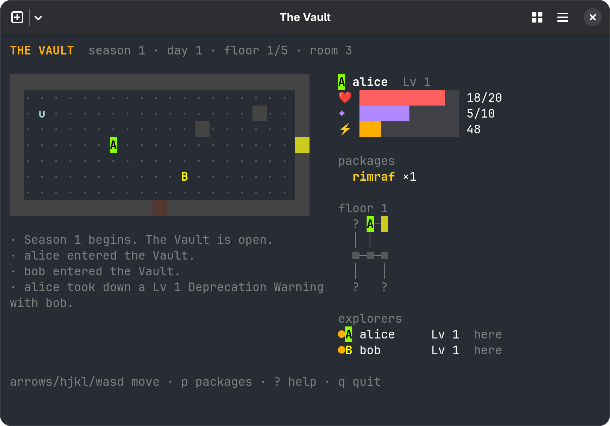
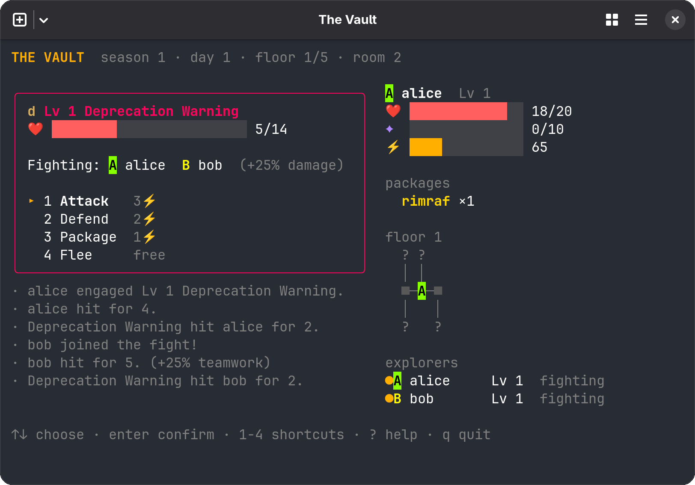

# The Vault

A shared co-op dungeon crawler for a multi-user dev server. Everyone who logs
in plays in the same dungeon: explore five floors, team up in fights, find the
access tokens for locked doors, and beat the boss on floor 5 to win the season.

This was developed for a hacktathon at [vlt.io](https://vlt.io). The idea was to
make a game that could be played on a shared dev server for a few minutes per day
at most.





It's one static Go binary and a SQLite file. There's no daemon: you get fresh
energy every day at 3 AM ET (Toronto), and the world ticks whenever someone
next runs the game.

## Try it locally

```sh
make build              # test binary, saves to ./thevault-dev.db
./thevault              # play
USER=bob ./thevault     # second player, in another terminal
```

## Commands

```
thevault          play (arrow keys, hjkl or wasd to move)
thevault motd     today's news and your room
thevault who      everyone's stats
thevault log      recent happenings
thevault help     rules and controls
```

## Install on a server

```sh
sudo make install
sudo usermod -aG thevault alice   # repeat for each player
```

See [deploy/README.md](deploy/README.md) for details.

## Development

```sh
make test
```
